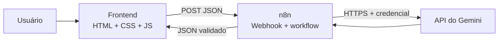
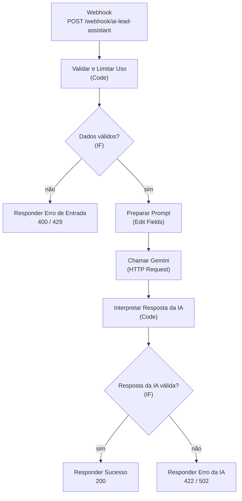
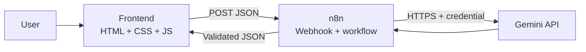
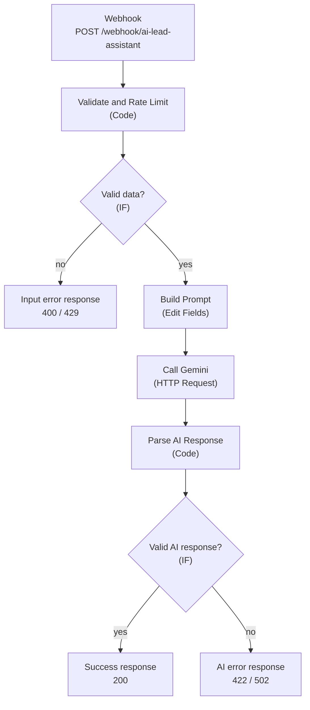

# AI Lead Assistant

**[Português (BR)](#português-br) · [English](#english)**

---

## Português (BR)

Aplicação web que recebe mensagens de possíveis clientes e usa **IA (Google Gemini)** e **automação (n8n)** para classificá-las: categoria, prioridade, resumo e sugestão de resposta em português.

> Projeto de portfólio, feito para ser pequeno e funcional. É uma versão demonstrativa: não use em produção sem as medidas de segurança listadas em [Limitações](#limitações-e-segurança).

### Objetivo

Equipes pequenas recebem mensagens de contato misturadas (orçamentos, dúvidas, problemas urgentes) e perdem tempo na triagem. O projeto faz essa triagem inicial e propõe uma resposta. A resposta é **apenas exibida**: nada é enviado a ninguém automaticamente.

### Para quem está avaliando

O que o projeto demonstra:

- **Integração real por API e webhook:** o frontend chama o n8n por HTTP, e o n8n chama o Gemini. Nada é simulado.
- **Automação com n8n:** validação, ramificação com IF, tratamento de erros e respostas HTTP com código correto.
- **IA usada com controle:**
  - saída estruturada (JSON Schema com valores fixos para categoria e prioridade);
  - a resposta do modelo é validada de novo antes de chegar ao usuário;
  - a mensagem do contato é tratada como dado não confiável (proteção contra injeção de prompt);
  - a IA só sugere, não executa ações.
- **Segurança básica:** chave de API só no n8n, validação no frontend **e** no servidor, limite de uso, CORS configurável e texto da IA inserido com `textContent` (sem XSS).
- **Qualidade:** 58 testes automatizados, incluindo um que garante que frontend e n8n usam as mesmas regras e o mesmo formato de JSON.

Decisões de projeto:

| Decisão | Motivo |
|---|---|
| JavaScript puro, sem framework nem banco | Escopo pequeno e execução rápida |
| n8n valida os dados de novo | O frontend pode ser contornado com `curl` |
| URL do webhook em `js/config.js` | Frontend estático não lê variáveis de ambiente; a chave fica só no n8n |
| Funções de validação em `js/utils.js` | Podem ser testadas sem navegador |

### Como funciona





Detalhes de cada nó, contrato da API, CORS, limite de uso e prompt: [`docs/workflow.md`](docs/workflow.md).

### Stack

| Camada | Tecnologia |
|---|---|
| Frontend | HTML5, CSS3, JavaScript puro (sem dependências) |
| Automação | [n8n](https://n8n.io): Webhook, Code, IF, Edit Fields, HTTP Request, Respond to Webhook |
| IA | API do Google Gemini (`generateContent`, saída JSON estruturada) |
| Testes | `node --test` (nativo do Node.js) |

### Funcionalidades

- Formulário com nome, e-mail, assunto e mensagem (10 a 2000 caracteres), com validação e indicadores de carregamento, sucesso e erro.
- Categorias: `Dúvida`, `Orçamento`, `Suporte`, `Outro`. Prioridades: `Baixa`, `Média`, `Alta`.
- Cards de resultado com cor por prioridade e botão para copiar a resposta sugerida.
- Tratamento de falha de conexão, tempo esgotado, resposta inválida e erro da API de IA.
- Layout responsivo com tema claro e escuro automático.

### Estrutura de pastas

```
ai-lead-assistant/
├── index.html                          # página
├── css/style.css                       # estilos
├── js/
│   ├── config.js                       # URL do webhook (único arquivo a editar)
│   ├── utils.js                        # validação e interpretação da resposta
│   └── app.js                          # interface e requisição
├── n8n/ai-lead-assistant-workflow.json # workflow para importar (sem chaves)
├── docs/workflow.md                    # detalhes técnicos do workflow
├── tests/                              # testes automatizados
├── package.json                        # só o script "npm test"
├── .env.example
└── .gitignore
```

### Como executar

Testado com Node.js 22 e n8n 2.35.7.

**Pré-requisitos:** [Node.js](https://nodejs.org) (versão LTS), Python 3 (ou Node, para servir o frontend), um navegador e uma chave gratuita do Gemini.

**1. Obter o projeto**

```bash
git clone https://github.com/SEU-USUARIO/NOME-DO-REPOSITORIO.git
cd NOME-DO-REPOSITORIO
```

**2. Criar a chave do Gemini**

Acesse <https://aistudio.google.com/apikey>, crie uma chave e guarde-a. Ela será colada **somente** no n8n (passo 5). Nunca a coloque em arquivos do projeto.

**3. Iniciar o n8n** (deixe este terminal aberto)

```bash
npx n8n
```

Na primeira vez o download pode levar alguns minutos. Abra <http://localhost:5678> e crie a conta local de administrador.

**4. Importar o workflow**

No n8n, crie um workflow vazio, abra o menu **⋯ > Import from File…** e selecione `n8n/ai-lead-assistant-workflow.json`.

**5. Configurar a chave**

1. Dê dois cliques no nó **Chamar Gemini**.
2. Em *Credential for Header Auth*, clique em **Connect to Header Auth** (ou *Create new credential*).
3. Preencha **Name:** `x-goog-api-key` e **Value:** sua chave. Nomeie a credencial `Gemini API Key` e salve.

**6. Publicar o workflow**

Salve (`Ctrl+S`) e clique em **Publish** (versões antigas: chave *Active*). O webhook de produção fica em:

```
http://localhost:5678/webhook/ai-lead-assistant
```

Se a sua URL for outra, edite `WEBHOOK_URL` em [`js/config.js`](js/config.js).

**7. Testar o n8n sem o site**

Linux/macOS ou Git Bash:

```bash
curl -s -X POST http://localhost:5678/webhook/ai-lead-assistant -H "Content-Type: application/json" -d '{"nome":"Maria Exemplo","email":"maria@exemplo.com","assunto":"Orçamento","mensagem":"Gostaria de um orçamento para um site institucional com 5 páginas."}'
```

PowerShell:

```powershell
Invoke-RestMethod -Method Post -Uri http://localhost:5678/webhook/ai-lead-assistant -ContentType "application/json; charset=utf-8" -Body '{"nome":"Maria Exemplo","email":"maria@exemplo.com","assunto":"Orçamento","mensagem":"Gostaria de um orçamento para um site institucional com 5 páginas."}'
```

Esperado: JSON com `"sucesso": true` e os campos `categoria`, `resumo`, `prioridade` e `resposta_sugerida`.

**8. Abrir o site** (outro terminal, na pasta do projeto)

```bash
python -m http.server 8080
```

No Windows pode ser `py -m http.server 8080`. Sem Python: `npx --yes serve -l 8080 .`. Abra <http://localhost:8080> e envie uma mensagem com dados **fictícios**. Não abra o `index.html` com duplo clique: o navegador bloqueia a chamada ao n8n.

**CORS:** o padrão `*` do nó Webhook serve para uso local. Para restringir, use a origem exata do site (por exemplo, `http://localhost:8080`) em *Webhook > Options > Allowed Origins*.

### Exemplos

Entrada (`POST /webhook/ai-lead-assistant`):

```json
{
  "nome": "Maria Exemplo",
  "email": "maria@exemplo.com",
  "assunto": "Orçamento para site",
  "mensagem": "Olá! Gostaria de um orçamento para um site institucional com 5 páginas."
}
```

Saída de sucesso (HTTP 200; o texto varia a cada execução):

```json
{
  "sucesso": true,
  "dados": {
    "categoria": "Orçamento",
    "resumo": "O contato deseja um orçamento para um site institucional com 5 páginas.",
    "prioridade": "Média",
    "resposta_sugerida": "Olá, Maria! Obrigado pelo contato. Poderia informar o segmento da empresa e as páginas desejadas?\n\nEquipe de Atendimento"
  }
}
```

Saída de erro (HTTP 400):

```json
{
  "sucesso": false,
  "codigo": "VALIDACAO",
  "erro": "Dados inválidos: Informe um e-mail válido.",
  "detalhes": ["Informe um e-mail válido."]
}
```

Códigos de erro: `VALIDACAO`, `LIMITE_EXCEDIDO`, `IA_BLOQUEADA`, `IA_INDISPONIVEL`, `IA_RESPOSTA_INVALIDA` (veja [`docs/workflow.md`](docs/workflow.md#respostas-de-erro)).

### Testes

Automatizados (sem `npm install`):

```bash
npm test
```

São 58 testes: validação do formulário, interpretação da resposta, o código real dos nós do workflow com entradas válidas e inválidas, consistência entre frontend e n8n e ausência de chaves nos arquivos.

Manuais (use dados fictícios; a IA varia, então a categoria é o que se espera):

| # | Cenário | Como fazer | Esperado |
|---|---|---|---|
| 1 | Mensagem válida | Preencha o formulário com dados fictícios | Cards de resultado e mensagem de sucesso |
| 2 | Orçamento | `Gostaria de um orçamento para um site com 5 páginas.` | Categoria **Orçamento** |
| 3 | Suporte | `Não consigo acessar minha conta e é urgente.` | Categoria **Suporte**, prioridade normalmente **Alta** |
| 4 | Campos vazios | Envie sem preencher | Erro em cada campo, sem requisição na aba *Network* |
| 5 | E-mail inválido | `maria@` | Erro no campo. No servidor: HTTP 400 `VALIDACAO` |
| 6 | Webhook indisponível | Pare o n8n ou despublique o workflow | "Não foi possível conectar ao servidor de automação…" |
| 7 | Falha na API de IA | Coloque um valor inválido na credencial e envie (restaure depois) | "O serviço de IA está indisponível…" (HTTP 502) |
| 8 | Resposta inválida da IA | Veja [Simulando falhas](docs/workflow.md#simulando-falhas-para-testes-manuais) | "…resposta em formato inesperado…" (HTTP 502) |
| 9 | Copiar resposta | Clique em **Copiar resposta** e cole em um editor | Texto igual ao exibido |

Limite de uso (consome 10 chamadas da sua cota; esperado: dez `200` e depois `429`):

```bash
for i in $(seq 1 12); do curl -s -o /dev/null -w "%{http_code} " -X POST http://localhost:5678/webhook/ai-lead-assistant -H "Content-Type: application/json" -d '{"nome":"Maria Exemplo","email":"maria@exemplo.com","assunto":"Teste","mensagem":"Pergunta de teste número '$i' sobre o serviço?"}'; done; echo
```

### Problemas comuns

| Sintoma | Causa provável |
|---|---|
| "Não foi possível conectar ao servidor de automação…" | n8n parado, workflow não publicado (URL `/webhook/`) ou editor não escutando (URL `/webhook-test/`), URL errada em `js/config.js` ou CORS. Veja o console (F12) |
| "O serviço de IA está indisponível…" | Chave inválida, credencial não selecionada no nó, cota esgotada ou modelo inexistente. O erro detalhado fica em **Executions** no n8n |
| Erro de CORS no console | Informe a origem exata em *Allowed Origins* (sem `/` no final) |

O modelo padrão é `gemini-3.5-flash-lite`. Se for renomeado ou descontinuado, edite o campo `modelo` no nó **Preparar Prompt** (veja [`docs/workflow.md`](docs/workflow.md#trocar-o-modelo)).

### Limitações e segurança

- O webhook não tem autenticação. O limite de uso (10 pedidos por minuto por IP e 300 por hora no total) é básico e o IP pode ser forjado sem um proxy confiável.
- A classificação por IA pode errar e varia entre execuções. A sugestão deve ser revisada por uma pessoa.
- As proteções contra injeção de prompt reduzem o risco, mas não o eliminam.
- O texto enviado vai para a API do Google e fica no histórico de execuções do n8n. **Não use dados pessoais reais.**
- Sem banco de dados, histórico de mensagens, envio de e-mails ou painel (por escolha de escopo).
- Interface e prompt apenas em português do Brasil. Os nomes de modelo do Gemini mudam com o tempo.

Para uso real faltariam autenticação do webhook, rate limiting em proxy, CAPTCHA, política de privacidade (LGPD) e monitoramento de custos.

### Melhorias futuras

- Autenticação do webhook e um pequeno backend entre o navegador e o n8n.
- CAPTCHA e rate limiting em proxy ou Redis.
- Salvar os contatos classificados (planilha ou banco) e criar um painel.
- Notificar a equipe com aprovação humana antes de qualquer envio.
- Conjunto de mensagens de referência para medir a acurácia ao trocar modelo ou prompt.
- Testes de ponta a ponta no navegador e integração contínua.

---

## English

A web app that receives messages from potential customers and uses **AI (Google Gemini)** and **automation (n8n)** to classify them: category, priority, summary, and a suggested reply in Brazilian Portuguese.

> Portfolio project, intentionally small and functional. It is a demo version: do not use it in production without the measures listed in [Limitations](#limitations-and-security).

### Goal

Small teams get mixed contact messages (quotes, questions, urgent problems) and spend time triaging them. This project does the first triage and drafts a reply. The reply is **only displayed**: nothing is sent to anyone automatically.

### For reviewers

What the project demonstrates:

- **Real API and webhook integration:** the frontend calls n8n over HTTP, and n8n calls Gemini. Nothing is mocked.
- **Automation with n8n:** validation, IF branching, error handling, and correct HTTP status codes.
- **AI used with control:**
  - structured output (JSON Schema with fixed values for category and priority);
  - the model response is validated again before reaching the user;
  - the contact message is treated as untrusted data (prompt injection mitigation);
  - the AI only suggests, it never performs actions.
- **Basic security:** API key only in n8n, validation in the frontend **and** the server, rate limiting, configurable CORS, and AI text inserted with `textContent` (no XSS).
- **Quality:** 58 automated tests, including one that checks that the frontend and n8n share the same rules and JSON format.

Design decisions:

| Decision | Reason |
|---|---|
| Plain JavaScript, no framework or database | Small scope and fast delivery |
| n8n validates the data again | The frontend can be bypassed with `curl` |
| Webhook URL in `js/config.js` | A static frontend cannot read environment variables; the key stays only in n8n |
| Validation functions in `js/utils.js` | They can be tested without a browser |

### How it works





Node names in the workflow file are in Portuguese. Per-node details, API contract, CORS, rate limiting, and the prompt are in [`docs/workflow.md`](docs/workflow.md) (Portuguese).

### Stack

| Layer | Technology |
|---|---|
| Frontend | HTML5, CSS3, plain JavaScript (no dependencies) |
| Automation | [n8n](https://n8n.io): Webhook, Code, IF, Edit Fields, HTTP Request, Respond to Webhook |
| AI | Google Gemini API (`generateContent`, structured JSON output) |
| Tests | `node --test` (built into Node.js) |

### Features

- Form with name, email, subject, and message (10 to 2000 characters), with validation and loading, success, and error indicators.
- Categories: `Dúvida` (question), `Orçamento` (quote), `Suporte` (support), `Outro` (other). Priorities: `Baixa` (low), `Média` (medium), `Alta` (high). The values returned by the API are in Portuguese.
- Result cards with a color per priority and a button to copy the suggested reply.
- Handles connection failures, timeouts, invalid responses, and AI API errors.
- Responsive layout with automatic light and dark theme.

### Project structure

```
ai-lead-assistant/
├── index.html                          # page
├── css/style.css                       # styles
├── js/
│   ├── config.js                       # webhook URL (the only file to edit)
│   ├── utils.js                        # validation and response parsing
│   └── app.js                          # UI and request
├── n8n/ai-lead-assistant-workflow.json # workflow to import (no keys)
├── docs/workflow.md                    # workflow technical details
├── tests/                              # automated tests
├── package.json                        # only the "npm test" script
├── .env.example
└── .gitignore
```

### How to run

Tested with Node.js 22 and n8n 2.35.7.

**Prerequisites:** [Node.js](https://nodejs.org) (LTS), Python 3 (or Node, to serve the frontend), a browser, and a free Gemini API key.

**1. Get the project**

```bash
git clone https://github.com/YOUR-USERNAME/REPOSITORY-NAME.git
cd REPOSITORY-NAME
```

**2. Create the Gemini key**

Go to <https://aistudio.google.com/apikey>, create a key, and keep it. You will paste it **only** into n8n (step 5). Never put it in project files.

**3. Start n8n** (keep this terminal open)

```bash
npx n8n
```

The first run may take a few minutes to download. Open <http://localhost:5678> and create the local admin account.

**4. Import the workflow**

In n8n, create an empty workflow, open the **⋯ menu > Import from File…**, and select `n8n/ai-lead-assistant-workflow.json`.

**5. Set up the key**

1. Double-click the **Chamar Gemini** node (Call Gemini).
2. Under *Credential for Header Auth*, click **Connect to Header Auth** (or *Create new credential*).
3. Fill in **Name:** `x-goog-api-key` and **Value:** your key. Name the credential `Gemini API Key` and save.

**6. Publish the workflow**

Save (`Ctrl+S`) and click **Publish** (older versions: the *Active* toggle). The production webhook is at:

```
http://localhost:5678/webhook/ai-lead-assistant
```

If your URL is different, edit `WEBHOOK_URL` in [`js/config.js`](js/config.js).

**7. Test n8n without the site**

Linux/macOS or Git Bash:

```bash
curl -s -X POST http://localhost:5678/webhook/ai-lead-assistant -H "Content-Type: application/json" -d '{"nome":"Maria Exemplo","email":"maria@exemplo.com","assunto":"Orçamento","mensagem":"Gostaria de um orçamento para um site institucional com 5 páginas."}'
```

PowerShell:

```powershell
Invoke-RestMethod -Method Post -Uri http://localhost:5678/webhook/ai-lead-assistant -ContentType "application/json; charset=utf-8" -Body '{"nome":"Maria Exemplo","email":"maria@exemplo.com","assunto":"Orçamento","mensagem":"Gostaria de um orçamento para um site institucional com 5 páginas."}'
```

Expected: JSON with `"sucesso": true` and the fields `categoria`, `resumo`, `prioridade`, and `resposta_sugerida`. (The API fields are in Portuguese: category, summary, priority, suggested reply.)

**8. Open the site** (another terminal, in the project folder)

```bash
python -m http.server 8080
```

On Windows it may be `py -m http.server 8080`. Without Python: `npx --yes serve -l 8080 .`. Open <http://localhost:8080> and send a message with **fictional** data. Do not open `index.html` by double-clicking: the browser blocks the call to n8n.

**CORS:** the default `*` on the Webhook node is fine for local use. To restrict it, set the exact site origin (for example, `http://localhost:8080`) in *Webhook > Options > Allowed Origins*.

### Examples

Input (`POST /webhook/ai-lead-assistant`):

```json
{
  "nome": "Maria Exemplo",
  "email": "maria@exemplo.com",
  "assunto": "Orçamento para site",
  "mensagem": "Olá! Gostaria de um orçamento para um site institucional com 5 páginas."
}
```

Success output (HTTP 200; the text varies on each run):

```json
{
  "sucesso": true,
  "dados": {
    "categoria": "Orçamento",
    "resumo": "O contato deseja um orçamento para um site institucional com 5 páginas.",
    "prioridade": "Média",
    "resposta_sugerida": "Olá, Maria! Obrigado pelo contato. Poderia informar o segmento da empresa e as páginas desejadas?\n\nEquipe de Atendimento"
  }
}
```

Error output (HTTP 400):

```json
{
  "sucesso": false,
  "codigo": "VALIDACAO",
  "erro": "Dados inválidos: Informe um e-mail válido.",
  "detalhes": ["Informe um e-mail válido."]
}
```

Error codes: `VALIDACAO`, `LIMITE_EXCEDIDO`, `IA_BLOQUEADA`, `IA_INDISPONIVEL`, `IA_RESPOSTA_INVALIDA` (see [`docs/workflow.md`](docs/workflow.md#respostas-de-erro)).

### Tests

Automated (no `npm install` needed):

```bash
npm test
```

58 tests cover: form validation, response parsing, the real workflow node code run with valid and invalid inputs, frontend/n8n consistency, and absence of keys in the files.

Manual (use fictional data; the AI varies, so the category is what to expect):

| # | Scenario | How | Expected |
|---|---|---|---|
| 1 | Valid message | Fill in the form with fictional data | Result cards and a success message |
| 2 | Quote request | `Gostaria de um orçamento para um site com 5 páginas.` | Category **Orçamento** |
| 3 | Support request | `Não consigo acessar minha conta e é urgente.` | Category **Suporte**, priority usually **Alta** |
| 4 | Empty fields | Submit without filling anything | An error on each field, no request in the *Network* tab |
| 5 | Invalid email | `maria@` | Field error. On the server: HTTP 400 `VALIDACAO` |
| 6 | Webhook unavailable | Stop n8n or unpublish the workflow | "Não foi possível conectar ao servidor de automação…" (could not connect) |
| 7 | AI API failure | Set an invalid value in the credential and submit (restore it afterwards) | "O serviço de IA está indisponível…" (AI service unavailable, HTTP 502) |
| 8 | Invalid AI response | See [Simulating failures](docs/workflow.md#simulando-falhas-para-testes-manuais) | "…resposta em formato inesperado…" (unexpected format, HTTP 502) |
| 9 | Copy reply | Click **Copiar resposta** and paste in an editor | Text identical to the one shown |

Rate limit (uses 10 calls of your quota; expected: ten `200` then `429`):

```bash
for i in $(seq 1 12); do curl -s -o /dev/null -w "%{http_code} " -X POST http://localhost:5678/webhook/ai-lead-assistant -H "Content-Type: application/json" -d '{"nome":"Maria Exemplo","email":"maria@exemplo.com","assunto":"Teste","mensagem":"Pergunta de teste número '$i' sobre o serviço?"}'; done; echo
```

### Troubleshooting

| Symptom | Likely cause |
|---|---|
| "Não foi possível conectar ao servidor de automação…" | n8n stopped, workflow not published (`/webhook/` URL) or editor not listening (`/webhook-test/` URL), wrong URL in `js/config.js`, or CORS. Check the console (F12) |
| "O serviço de IA está indisponível…" | Invalid key, credential not selected on the node, quota exhausted, or nonexistent model. The detailed error is in **Executions** in n8n |
| CORS error in the console | Set the exact origin in *Allowed Origins* (no trailing `/`) |

The default model is `gemini-3.5-flash-lite`. If it is renamed or discontinued, edit the `modelo` field in the **Preparar Prompt** node (see [`docs/workflow.md`](docs/workflow.md#trocar-o-modelo)).

### Limitations and security

- The webhook has no authentication. The rate limit (10 requests per minute per IP and 300 per hour overall) is basic, and the IP can be spoofed without a trusted proxy.
- AI classification can be wrong and varies between runs. A person should review the suggested reply.
- Prompt injection mitigations reduce the risk but do not eliminate it.
- The submitted text goes to Google's API and stays in n8n's execution history. **Do not use real personal data.**
- No database, message history, email sending, or dashboard (a scope choice).
- The UI and prompt are in Brazilian Portuguese only. Gemini model names change over time.

For real use, it would still need webhook authentication, proxy-level rate limiting, CAPTCHA, a privacy policy (LGPD/GDPR), and cost monitoring.

### Future improvements

- Webhook authentication and a small backend between the browser and n8n.
- CAPTCHA and rate limiting at a proxy or in Redis.
- Store classified contacts (spreadsheet or database) and add a dashboard.
- Notify the team with human approval before anything is sent.
- A reference message set to measure accuracy when changing model or prompt.
- Browser end-to-end tests and continuous integration.
