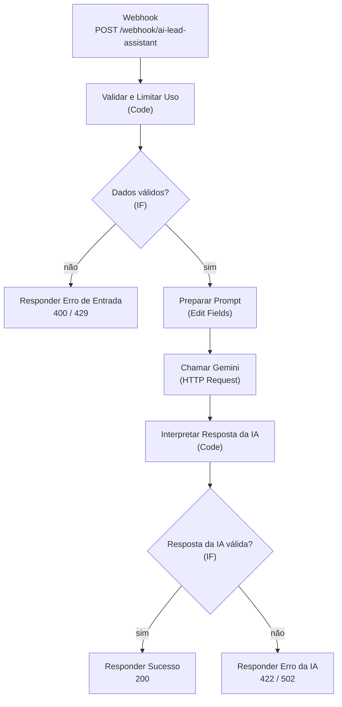

# Workflow do n8n — detalhes técnicos

Arquivo: [`n8n/ai-lead-assistant-workflow.json`](../n8n/ai-lead-assistant-workflow.json)
Testado com **n8n 2.35.7** e Node.js 22. Os tipos de nó usados exigem uma versão recente do n8n (por exemplo, o nó IF na versão 2.2 e o Set/Edit Fields na 3.4).

## Visão geral



## Contrato da API

### Requisição

`POST /webhook/ai-lead-assistant` com `Content-Type: application/json`:

```json
{
  "nome": "Maria Exemplo",
  "email": "maria@exemplo.com",
  "assunto": "Orçamento para site",
  "mensagem": "Olá! Gostaria de um orçamento para um site institucional com 5 páginas."
}
```

| Campo      | Regra                                  |
|------------|----------------------------------------|
| `nome`     | texto obrigatório, até 100 caracteres  |
| `email`    | e-mail válido, até 254 caracteres      |
| `assunto`  | texto obrigatório, até 150 caracteres  |
| `mensagem` | texto obrigatório, de 10 a 2000 caracteres |

### Resposta de sucesso (HTTP 200)

```json
{
  "sucesso": true,
  "dados": {
    "categoria": "Orçamento",
    "resumo": "O contato deseja um orçamento para um site institucional de 5 páginas.",
    "prioridade": "Média",
    "resposta_sugerida": "Olá, Maria! Obrigado pelo contato. Poderia compartilhar o segmento da empresa e as páginas desejadas?\n\nEquipe de Atendimento"
  }
}
```

`categoria` é sempre `Dúvida`, `Orçamento`, `Suporte` ou `Outro`; `prioridade` é sempre `Baixa`, `Média` ou `Alta`.

### Respostas de erro

Sempre JSON, no formato `{ "sucesso": false, "codigo": "...", "erro": "mensagem legível" }`:

| HTTP | `codigo`              | Quando acontece                                                       |
|------|-----------------------|-----------------------------------------------------------------------|
| 400  | `VALIDACAO`           | Campo ausente, vazio, com tipo errado ou fora dos limites. Traz também `detalhes` (lista de problemas). |
| 429  | `LIMITE_EXCEDIDO`     | Limite de uso por IP ou limite global por hora atingido.              |
| 422  | `IA_BLOQUEADA`        | O modelo recusou analisar a mensagem (filtros de segurança).          |
| 502  | `IA_INDISPONIVEL`     | Falha na chamada à API do Gemini (chave inválida, cota, timeout, erro 5xx). |
| 502  | `IA_RESPOSTA_INVALIDA`| A IA respondeu fora do formato (texto livre, JSON truncado, valores fora da lista). |

Detalhes técnicos de falhas da IA (mensagem original da API) **não** são devolvidos ao navegador; ficam apenas no histórico de execuções do n8n.

## Nós, um por um

| Nó | Tipo | O que faz |
|----|------|-----------|
| **Webhook** | Webhook | Recebe o `POST`. Usa o modo *Using 'Respond to Webhook' node*, então a resposta é montada no fim do fluxo. Em *Options > Allowed Origins (CORS)* vem `*` por padrão. |
| **Validar e Limitar Uso** | Code | Valida e normaliza os 4 campos (tipo, tamanho, e-mail), remove caracteres de controle e aplica o limite de uso. Repete todas as regras do frontend, que não é confiável. |
| **Dados válidos?** | IF | Separa entradas válidas (`valido = true`) das recusadas. |
| **Preparar Prompt** | Edit Fields (Set) | Define `modelo`, `instrucaoSistema` (regras fixas) e `conteudoUsuario` (o contato serializado como JSON). |
| **Chamar Gemini** | HTTP Request | `POST` em `generativelanguage.googleapis.com/v1beta/models/{modelo}:generateContent`. Autentica com a credencial Header Auth. Timeout de 25 s, 2 tentativas e, se ainda falhar, segue o fluxo com o erro (`On Error: Continue`) para responder com uma mensagem amigável. |
| **Interpretar Resposta da IA** | Code | Extrai o texto, converte para JSON (tolera cercas ```` ```json ````), valida `categoria` e `prioridade`, exige `resumo` e `resposta_sugerida` e limita o tamanho. Converte qualquer falha em um erro padronizado. |
| **Resposta da IA válida?** | IF | Encaminha para a resposta de sucesso ou de erro. |
| **Responder Sucesso / Erro da IA / Erro de Entrada** | Respond to Webhook | Devolvem o JSON final com o código HTTP correto. |

## Prompt e proteção contra injeção de prompt

Medidas em camadas (nenhuma é infalível sozinha):

1. **Separação de papéis:** as regras vão em `systemInstruction`; o contato vai em `contents`, como um bloco JSON (`dados_do_contato`). A serialização com `JSON.stringify` escapa aspas e quebras de linha, então o texto do contato não consegue "fechar" o bloco e escrever instruções fora dele.
2. **Instrução explícita:** o prompt afirma que o contato é *dado não confiável*, manda ignorar pedidos para mudar regras, revelar o prompt, alterar o formato, escolher categoria/prioridade ou executar ações, e diz como classificar tentativas de manipulação (`Outro` / `Baixa`).
3. **Saída estruturada:** a requisição usa `responseMimeType: application/json` e um `responseSchema` com `enum` para categoria e prioridade.
4. **Validação da saída no n8n:** mesmo com o schema, o nó *Interpretar Resposta da IA* confere tudo de novo. Qualquer coisa fora do formato vira erro 502; nada é repassado sem validação.
5. **Sem ações externas:** o workflow não envia e-mails nem chama outros sistemas. A resposta sugerida só é exibida.
6. **Frontend seguro:** o texto da IA é inserido com `textContent`, nunca `innerHTML`.

Limitação: um modelo de linguagem pode, em teoria, ser enganado por mensagens bem elaboradas e gerar uma resposta sugerida indesejada (por exemplo, com um link). Por isso a interface avisa que a sugestão deve ser **revisada por uma pessoa** antes de qualquer uso.

## Credencial da API de IA

O workflow não contém chaves. O nó **Chamar Gemini** referencia uma credencial do n8n:

1. Crie uma credencial do tipo **Header Auth** chamada `Gemini API Key`.
2. **Name:** `x-goog-api-key` — **Value:** sua chave do Google AI Studio.
3. No nó **Chamar Gemini**, selecione essa credencial em *Credential for Header Auth*.

Ao importar o arquivo, o n8n mostra a credencial como pendente até você selecioná-la — isso é esperado.

## Trocar o modelo

No nó **Preparar Prompt**, edite o campo `modelo` (padrão: `gemini-3.5-flash-lite`). Consulte a lista de modelos vigentes no [site do Gemini API](https://ai.google.dev/gemini-api/docs/models). Modelos com raciocínio ("thinking") ativo por padrão consomem parte de `maxOutputTokens` (2048, no nó **Chamar Gemini**); se a resposta vier truncada, aumente esse valor.

## CORS

O navegador só aceita a resposta do n8n se a origem do frontend estiver permitida.

- **Desenvolvimento:** o padrão `*` funciona.
- **Mais seguro:** no nó **Webhook**, em *Options > Allowed Origins (CORS)*, troque `*` pela origem exata do seu frontend (por exemplo, `http://localhost:8080`).
- A origem é só o esquema, o host e a porta, sem caminho e sem `/` final.
- Se abrir `index.html` com `file://`, a origem será `null` e o CORS pode falhar. Sirva a pasta por HTTP (veja o README).
- CORS protege apenas navegadores: qualquer pessoa com `curl` ainda consegue chamar o webhook. Por isso existe o limite de uso abaixo.

## Limite de uso (rate limiting)

O nó **Validar e Limitar Uso** implementa uma proteção básica, guardada em *workflow static data*:

| Regra | Valor padrão |
|-------|--------------|
| Pedidos válidos por IP | 10 por minuto |
| Pedidos válidos no total | 300 por hora |

Para alterar, edite `MAX_POR_JANELA` e `MAX_GLOBAL_POR_HORA` no início do código do nó. Pontos importantes:

- Só pedidos **válidos** contam, porque são os que gastariam uma chamada à API de IA.
- O estado só é salvo em execuções de **produção** (workflow publicado/ativo, URL `/webhook/...`). Na URL de teste (`/webhook-test/...`) o limite não persiste entre chamadas.
- O IP vem do cabeçalho `X-Forwarded-For`/`X-Real-IP`. Sem um proxy reverso confiável, um cliente pode forjar esse cabeçalho e burlar o limite por IP; o **teto global por hora** continua valendo e protege a cota da API. Se nenhum cabeçalho existir, todos os clientes compartilham o mesmo contador.
- O contador fica na memória/dados do próprio workflow e não é compartilhado entre várias instâncias do n8n.

### Como fazer em produção

- Coloque o n8n atrás de um proxy reverso ou CDN (Nginx, Caddy, Cloudflare) que aplique rate limiting por IP real e repasse `X-Forwarded-For` de forma confiável.
- Exija um token no webhook (autenticação *Header Auth* no nó Webhook) e faça o frontend falar com um pequeno backend próprio, para o token não ficar público no navegador.
- Adicione um desafio anti-bot (Cloudflare Turnstile ou reCAPTCHA) validado no workflow.
- Para um limite distribuído, use um armazenamento compartilhado (por exemplo, Redis) consultado pelo workflow.
- Configure orçamento e alertas de cota na conta da API de IA.

## Privacidade

- O conteúdo do formulário é enviado à API do Gemini (Google). **Não use dados pessoais reais** em demonstrações.
- O n8n guarda os dados de cada execução (incluindo nome, e-mail e mensagem) no histórico. Em ambiente real, reduza a retenção (`EXECUTIONS_DATA_MAX_AGE`, `EXECUTIONS_DATA_PRUNE`) ou desative o salvamento de execuções bem-sucedidas em *Workflow Settings*.

## Simulando falhas (para testes manuais)

| Situação | Como provocar |
|----------|---------------|
| Webhook indisponível | Pare o n8n ou despublique o workflow. |
| Falha na API de IA | Edite a credencial `Gemini API Key` e coloque um valor inválido. O Gemini responde 400 e o frontend mostra "serviço de IA indisponível". Restaure a chave depois. |
| Resposta inválida da IA | Use a URL de teste (`/webhook-test/...`), clique em *Execute workflow* no editor, fixe (*Pin data*) no nó **Chamar Gemini** uma saída como `[{ "candidates": [{ "content": { "parts": [{ "text": "isto não é um JSON" }] } }] }]` e envie o formulário. |
| Limite de uso | Em produção, envie mais de 10 pedidos válidos em um minuto (veja o script no README). |

A lógica de interpretação das respostas inválidas também é verificada automaticamente em `tests/workflow.test.js`.
